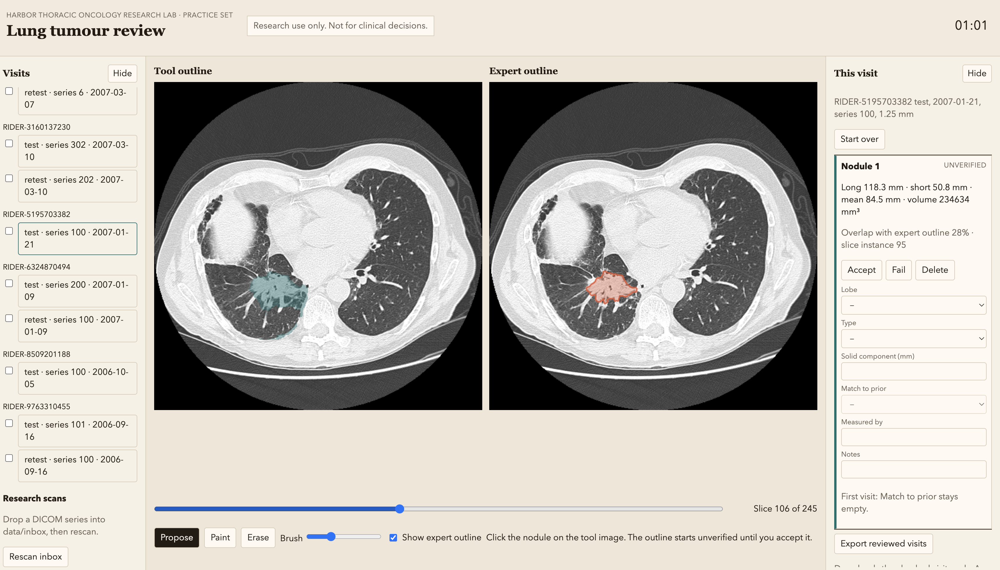

# Lung tumour review

Research use only. This is not a clinical device and it does not make a diagnosis.

A local page for outlining lung tumours on CT, reviewing the outline, and exporting measurements. On the practice set the page can show the manual expert outline beside the tool outline. On a new scan there is no expert outline, so the page is one viewer and the overlap score stays hidden.

The page runs on the machine that holds the scans. Nothing is uploaded.



## Run

```bash
python3 -m venv .venv
SAM2_BUILD_CUDA=0 .venv/bin/pip install -r requirements.txt
env -u PYTHONPATH .venv/bin/python -m app.server
```

Open http://127.0.0.1:8000 .

`PYTHONPATH` is cleared because some shells export a path that breaks this virtualenv. The first outline click downloads the MedSAM2 checkpoint into `checkpoints/` if it is not already there, then loads the model. Later clicks do not pay that load again. If the checkpoint or the model cannot be loaded, the same click uses a region grow and the page says MedSAM2 did not run.

## Demo mode and research mode

There is no mode switch. The left-hand list has two groups, and the visit you open decides which view you get.

**Demo mode** is any visit under **Practice set**. The lab asked to see the tool on their public practice scans, beside the expert outline, before they would trust it. That comparison is not part of the day-to-day job. A new hospital scan has no expert outline. Demo mode is there so a reviewer can see a hit and a miss first. Those visits exist after the practice CTs and the manual contours are downloaded, as described below. Open one and the page shows two viewers: the tool outline on the left and the expert outline on the right, with an overlap score on each nodule. **Show expert outline** hides the right viewer and the score, so you can rehearse the research workflow on a scan whose answer you can reveal again. Practice timepoints stay `test` and `retest`.

**Research mode** is any visit under **Research scans**. The page starts with none. Put a DICOM series in `data/inbox/<series>/*.dcm` and click **Rescan inbox**. The server does not need a restart. Open that visit and there is one viewer. There is no expert outline and no overlap score, because a new scan does not have one. Studies for one patient are ordered by study date. The earliest timepoint starts as `baseline`, and later studies start as `follow-up`, `follow-up 2`, and so on. That label can be edited. Match to prior stays empty on the earliest study.

Nodule finding stays a manual scroll in both modes. The tool does not search the scan for every nodule.

## Practice set

The practice scans are the public RIDER Lung CT collection and the manual gross-tumour outlines in RIDER-LungCT-Seg. Both are free to use with attribution. They are not in this repository.

Download them with the manifests in this repository:

```bash
env -u PYTHONPATH .venv/bin/python scripts/download_tcia_manifest.py \
  --manifest "RIDER-Lung-CT-Original-Scans-for-Leonard-Wee-Feb-10-2020-.tcia" \
  --dest data/ct
env -u PYTHONPATH .venv/bin/python scripts/download_tcia_manifest.py \
  --manifest "RIDER-Lung-CT-RTSTRUCTS-DICOM-SEGS-Leonard-Wee-Feb-10-2020.tcia" \
  --dest data/seg
```

The reference contour is the manual ROI (`GTVp_test_man` or `GTVp_retest_man`). The automatic contours are not used. The first launch reads the CT headers and those contours into `data/cache/`. Later launches reuse that cache. After that, the visits show up under **Practice set**, which is demo mode.

## Research scans

A research visit is a folder of DICOM slices, `data/inbox/<series>/*.dcm`. Click **Rescan inbox** and open it from **Research scans**. One series folder is one visit. The behavior of that visit is described under Demo mode and research mode above.

## Review

Click the nodule on the tool image. The outline starts unverified. Accept it if you leave it unchanged, paint or erase to mark it edited, or fail it if it is unusable. Only accepted and edited marks are exported. Failed and unverified marks stay on screen and are left out of the file.

Long axis, short axis, and mean diameter are in millimetres. Mean diameter is the average of the two axes. Volume is the voxel count times the voxel volume, in mm³, from the outline you accept, including after paint or erase. Lobe, type, solid component, measured by, and notes are typed, not calculated.

Export reviewed visits writes one CSV for the checked visits, in this column order: Patient ID, Scan date, Timepoint, Series #, Slice thickness (mm), Nodule ID, Lobe, Slice #, Type, Long axis (mm), Short axis (mm), Mean diameter (mm), Solid component (mm), Volume (mm3), Match to prior, Minutes on scan, Measured by, Notes. Minutes are the whole-visit total on the first row of that visit only. Match to prior is empty on a first visit and is Confident, Uncertain, or Not found on a later visit.

Marks and timers are saved in `data/cache/session.json` and survive a restart. Start over clears the open visit.

## Results

The longer write-up is [demo/out_of_box_results.md](demo/out_of_box_results.md). The numbers below are the short version.

### What works

A click proposes a 3D outline. Accept leaves it unchanged. Paint and erase correct it. Fail keeps a bad mark on screen and out of the file. Only accepted and edited marks are exported, in the lab's column order, and only for the visits that are checked.

On the hand walkthrough of RIDER-1129164940, the same-day volumes stayed close: 135,253 mm³ on the test and 130,610 mm³ on the retest. Those outlines overlapped the expert by 64% and 60%. The scans were taken the same day, so the tumour had not grown.

### What fails

Across 57 unedited proposals the median overlap is 47%, the median volume error is about 195%, and the median mean-diameter error is 30 mm.

The 47% is mostly extra tissue, not a missed nodule. Overlap falls when the outline is too big, even if the tumour sits inside it. On 54 of the 57 visits the tool outline is larger than the expert outline. Erasing that extra space is still work, and it can take as long as painting tissue the outline left out. Overlap stays the number used for the time estimate below. A separate score for how much of the expert sits inside the tool outline was not computed.

Five visits are actual misses. They overlap by 0–3%, and the outline is somewhere else, running onto many slices the expert left empty. Two visits produced no outline because the click landed on air. A click on the wrong object still gets an outline. The reviewer marks that failed. The tool does not search the scan for every nodule.

### Time

Daniel's outline takes 15–25 minutes, after 10–20 minutes of finding the nodule. This batch did not time him. Itay stood in, with the expert outline on screen, so the finding time is excluded.

Correction minutes are a scenario from the measured overlap:

- 70% or better: 4 minutes. 18 visits.
- From 40% up to 70%: 8 minutes. 12 visits.
- Under 40%, or no outline: 15 minutes, the bottom of the 15–25 minute hand outline. 29 visits. These are not faster.

The sheet step in the scenario is 2 minutes. His sheet step is 3–5 minutes. The median correction in the scenario is 8 minutes. The median estimated visit, including the sheet step, is 10 minutes. This is not Daniel's stopwatch, and it is not a claim about the whole week.

The first click took about 26 seconds, including the model load. Later clicks had a median of 21 seconds. Opening another visit reads that scan from disk again.

The per-visit scenario is [demo/itay_time_estimate.csv](demo/itay_time_estimate.csv). It is not Daniel's measurement sheet.

## Out-of-box evaluation

One click was placed at the center of the expert tumour on all 59 visits. Nothing was painted and nothing was accepted. The per-visit scores are [demo/eval_proposals.csv](demo/eval_proposals.csv). Those rows are not Daniel's sheet.

The same file is the baseline if the proposer is swapped. Rerun the batch, then the time scenario, and compare overlap, volume error, and diameter error visit by visit:

```bash
env -u PYTHONPATH .venv/bin/python scripts/evaluate_proposals.py
env -u PYTHONPATH .venv/bin/python scripts/time_estimate.py
```

## Not in this repository

The CT series, the segmentations, the MedSAM2 checkpoint, and `data/cache/` stay on the machine that runs the page. They are too large to publish, and the scans are downloaded from TCIA rather than stored here.

## Attribution

Zhao, B., Schwartz, L. H., Kris, M. G., & Riely, G. J. (2015). Coffee-break lung CT collection with scan images reconstructed at multiple imaging parameters (Version 3) [Dataset]. The Cancer Imaging Archive. https://doi.org/10.7937/k9/tcia.2015.u1x8a5nr

Wee, L., Aerts, H., Kalendralis, P., & Dekker, A. (2020). RIDER Lung CT Segmentation Labels from: Decoding tumour phenotype by noninvasive imaging using a quantitative radiomics approach [Data set]. The Cancer Imaging Archive. https://doi.org/10.7937/tcia.2020.jit9grk8

The outlines are described in Aerts et al., Nature Communications 2014, https://doi.org/10.1038/ncomms5006 .

The proposer is MedSAM2 (bowang-lab), checkpoint `MedSAM2_latest.pt`, config `sam2.1_hiera_t512`. Nothing here was trained on these patients.
